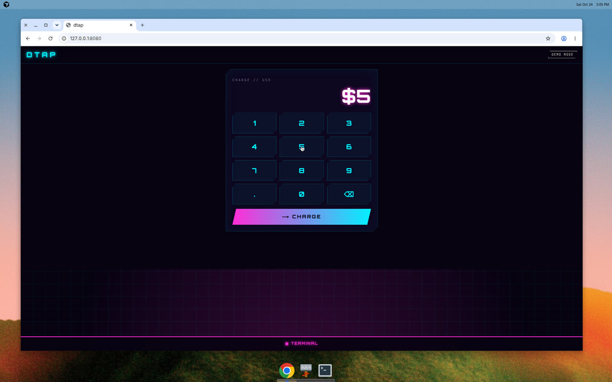
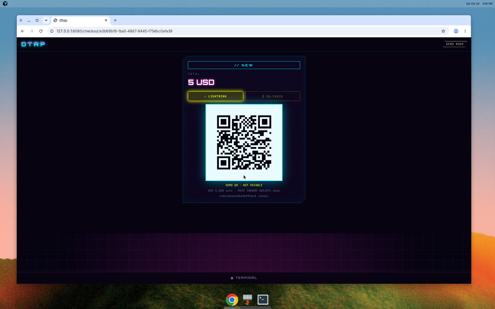
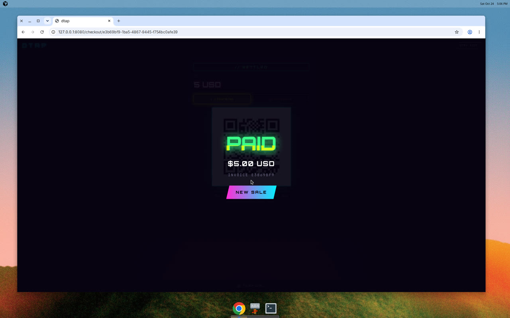
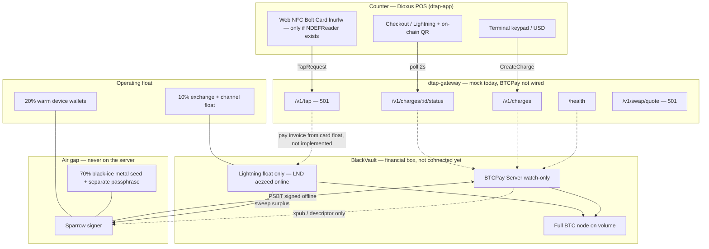

# DTap

A [point of sale](https://en.wikipedia.org/wiki/Point_of_sale) for merchants who want a counter that is not [Stripe](https://stripe.com/), [Square](https://squareup.com/us/en), [Toast](https://pos.toasttab.com/), or [Clover](https://www.clover.com/). A cashier rings a USD amount. The customer pays by QR or an [NFC Bolt Card](https://www.boltcard.org/). Settlement is designed to run through a server the shop controls, with [BTCPay Server](https://btcpayserver.org/) and a [Bitcoin full node](https://bitcoin.org/en/full-node). Spend keys never sit on that server.

Open source, MIT. Rust workspace: shared types in `crates/dtap-core`, a [Dioxus 0.7](https://dioxuslabs.com/learn/0.7/) terminal in `crates/dtap-app`, and an axum gateway in `crates/dtap-gateway`.

**What runs today is demo mode.** The mock gateway mints fake Lightning and on-chain invoices and walks them New → Processing → Settled. Real BTCPay wiring is not done. Demo mode does not move bitcoin. The terminal never holds a seed, mnemonic, xpub, or API key.

## Demo mode / Quick start

A stranger can record a $5 sale with no node and no wallet.

### Prerequisites

- rustup, stable toolchain (`rust-toolchain.toml` also pulls rustfmt and clippy)
- the `wasm32-unknown-unknown` target
- dioxus-cli 0.7 (the app is dioxus 0.7.10; install that cli)

```bash
rustup toolchain install stable
rustup target add wasm32-unknown-unknown
cargo install dioxus-cli --version 0.7.10 --locked
```

### Run it

From the repo root, two terminals:

```bash
make gateway
```

`make gateway` is `DTAP_MOCK=1 cargo run -p dtap-gateway`. It listens on `127.0.0.1:8787`.

```bash
cd crates/dtap-app
dx serve --platform web
```

Open <http://127.0.0.1:8080>. The dev server defaults to port 8080. Tap `5`, then `CHARGE`. The invoice QR is a demo payload (not payable). Status polls every 2 seconds: New, then Processing, then Settled, then the PAID screen. `NEW SALE` returns to the keypad. No transaction id is shown, because nothing was broadcast.





### How `DTAP_MOCK` works

| `DTAP_MOCK` | `BTCPAY_URL` + `BTCPAY_API_KEY` + `BTCPAY_STORE_ID` | Mode | `/health` |
| --- | --- | --- | --- |
| `1` or `true` | absent or present | mock | `{"blackvault":false,"mock":true}` |
| unset | absent | mock | `{"blackvault":false,"mock":true}` |
| unset | all three set | not mock | `{"blackvault":false,"mock":false}` |
| `0` or `false` | absent or present | not mock | `{"blackvault":false,"mock":false}` |

`blackvault` is true only when a real BTCPay client is connected. That client is not implemented, so a non-mock gateway does not pretend the vault is up. The BTCPay variables are optional: the process compiles and starts without them. Put them in the gateway environment only, never in `dtap-app`.

The app chip reads `mock` (`#[serde(default)]`, so an older payload still decodes). Mock shows a neutral **DEMO MODE** chip. A live vault would show **BLACKVAULT // LINKED**. Anything else, including a gateway that is down, shows **BLACKVAULT // DOWN**.

Other gateway environment:

- `DTAP_BIND` — listen address, default `127.0.0.1:8787`
- `DTAP_TERMINAL_TOKEN` — bearer token, default `dev-terminal-token` (a dev default, not a BTCPay key)
- `DTAP_CORS_ORIGINS` — comma-separated origins, default `http://127.0.0.1:8080,http://localhost:8080`

Allowed CORS headers are `authorization`, `content-type`, and `x-dtap-mock-status`. Browser preflight is not authenticated. Every other route requires `Authorization: Bearer <DTAP_TERMINAL_TOKEN>` and returns `401` JSON `{"error":"unauthorized"}` otherwise. The terminal bakes the same default token at compile time (`DTAP_TERMINAL_TOKEN` / `DTAP_GATEWAY_URL` via `option_env!`).

Mock invoices use a fixed **100000 USD/BTC demo** rate, so $5 is due as `5,000 sats`. QR payloads are prefixed `dtap-demo:` and labeled demo. There is no `OPEN FULL CHECKOUT` link in mock mode (the old `demo.dtap.local` host is not a real site). The counter only lists Lightning and on-chain Bitcoin. Monero, Liquid, stablecoins, and the exchange lab are not offered; the gateway cannot settle them.

### Force Settled

Create a charge (201 with the token, 401 without):

```bash
curl -sS -D - \
  -H "Authorization: Bearer dev-terminal-token" \
  -H "Content-Type: application/json" \
  -d '{"amount":"5.00","currency":"USD"}' \
  http://127.0.0.1:8787/v1/charges
```

`/v1/charges/INVOICE_ID/status` returns a bare PascalCase status (`"New"`, `"Processing"`, `"Settled"`, `"Expired"`, `"Invalid"`). Force it:

```bash
curl -sS \
  -H "Authorization: Bearer dev-terminal-token" \
  "http://127.0.0.1:8787/v1/charges/INVOICE_ID/status?status=settled"
```

Or with the header:

```bash
curl -sS \
  -H "Authorization: Bearer dev-terminal-token" \
  -H "X-DTap-Mock-Status: settled" \
  "http://127.0.0.1:8787/v1/charges/INVOICE_ID/status"
```

Both return `"Settled"`. An unknown `?status=` returns `400` JSON `{"error":"unknown status"}`. Time still moves a normal charge on its own: New for 3 seconds, Processing until 8 seconds, then Settled. The terminal stops polling on a final status or a 404.

Malformed JSON is a JSON error, not a plain-text axum rejection:

```bash
curl -sS -D - \
  -H "Authorization: Bearer dev-terminal-token" \
  -H "Content-Type: application/json" \
  -d '{bad' \
  http://127.0.0.1:8787/v1/charges
```

Bolt Card tap and swap quotes are not configured. They return `501` JSON. On the web, the tap button is rendered only when `NDEFReader` exists on `window` (Chrome on Android). A failed tap says to use QR. It does not dump the raw `501` body.

## Architecture



The dashed lines into BlackVault are the intended wiring. The mock gateway does not open them.

## Wallets ready?

What “ready” means before any real wallet:

- Analog notebook (or stamped metal) with the exact words, written by hand, stored where you already keep other irreplaceable things.
- Passphrase separate from the seed.
- Sparrow watch-only xpub/descriptor exported and verified on an air-gapped machine.
- Lightning (LND aezeed) created only as float, never from the same seed as the cold stack.
- XMR view key / wallet created the same careful way, if that rail is ever added.

Only then import the public material into BTCPay on BlackVault. Until a BTCPay client exists in `dtap-gateway`, the process cannot spend. Demo mode cannot spend either.
